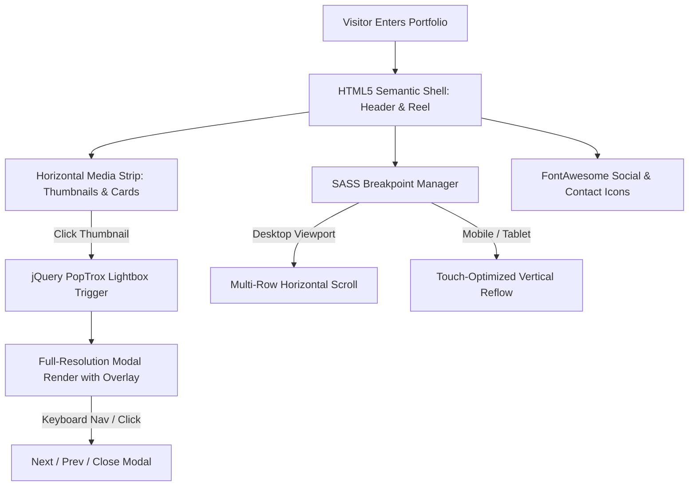

<div align="center">


[](https://developer.mozilla.org/en-US/docs/Web/HTML)
[](https://developer.mozilla.org/en-US/docs/Web/CSS)
[](https://sass-lang.com/)
[](https://developer.mozilla.org/en-US/docs/Web/JavaScript)
[](LICENSE.txt)
[](#)

</div>

---

## 📌 Executive Summary / Overview

**Parallelism Portfolio Template** (`Portfolio_Template`) is an ultra-responsive, horizontally scrolling personal portfolio and creative gallery interface based on the celebrated HTML5 UP design architecture. Engineered for digital artists, photographers, software developers, and visual designers, the project provides a distinctive cinematic presentation layout.

Unlike standard vertically stacked web pages, Parallelism introduces a smooth horizontal gallery strip coupled with jQuery PopTrox lightbox modal previews, touch gesture support, modular SASS mixins, and responsive breakpoint controllers. This repository houses the complete production-ready source code, modular stylesheet hierarchy, and sample media assets.

---

## 📖 Interactive Table of Contents

- [Executive Summary / Overview](#-executive-summary--overview)
- [Key Features & Capabilities](#-key-features--capabilities)
- [System Architecture & Interaction Flow](#-system-architecture--interaction-flow)
- [Tech Stack Breakdown](#-tech-stack-breakdown)
- [Responsive Breakpoint Architecture](#-responsive-breakpoint-architecture)
- [Reproducible Quickstart & Setup](#-reproducible-quickstart--setup)
- [Project Directory Layout](#-project-directory-layout)
- [Author & Licensing](#-author--licensing)

---

## ✨ Key Features & Capabilities

- **Fluid Horizontal Gallery Scrolling**: Cinematic horizontal timeline layout optimizing visual storytelling and media discovery across desktop and touchscreens.
- **PopTrox Lightbox Modal Engine**: Built-in modal window mechanism featuring high-resolution image zoom, smooth fade transitions, caption rendering, and keyboard ESC/Arrow controls.
- **Modular SASS Stylesheet Hierarchy**: Cleanly structured `.scss` source trees separating responsive mixins (`_mixins.scss`), design tokens (`_vars.scss`), responsive vendor prefixes (`_vendor.scss`), and media query breakpoints (`_breakpoints.scss`).
- **FontAwesome Iconography**: Integrated FontAwesome vector icon library for social links, external repository badges, and interactive controls.
- **Progressive Enhancement & NoScript Fallback**: Dedicated `noscript.css` styling ensuring graceful degradation for accessibility clients and script-disabled browsers.

---

## 🏗️ System Architecture & Interaction Flow



---

## 🛠️ Tech Stack Breakdown

| Category | Technologies & Tools |
| :--- | :--- |
| **Markup Language** | HTML5 (Semantic Structure, Meta Viewports, Clean Microdata) |
| **CSS Preprocessor**| SASS / SCSS (Modular Partials, Variables, Reusable Mixins) |
| **Compiled Styles** | CSS3 (Flexbox, Overlays, Transitions, Keyframes) |
| **Scripting & Plugins** | Vanilla JavaScript, jQuery, `jquery.poptrox.min.js`, `breakpoints.min.js` |
| **Iconography & Fonts**| FontAwesome 5 Free (SVG, TTF, WOFF, WOFF2 webfonts) |

---

## 📱 Responsive Breakpoint Architecture

| Breakpoint Tier | Media Query Range | Layout Behavior |
| :--- | :--- | :--- |
| **XLarge** | $\ge 1680\text{px}$ | Extended wide-screen horizontal strip with expanded reel gutters |
| **Large** | $1280\text{px} \dots 1679\text{px}$ | Standard high-density horizontal gallery display |
| **Medium** | $980\text{px} \dots 1279\text{px}$ | Compact horizontal scroll with optimized thumbnail dimensions |
| **Small / Mobile** | $\le 979\text{px}$ | Responsive vertical column reflow with full touch-swipe navigation |

---

## 🚀 Reproducible Quickstart & Setup

### Prerequisites
- Any modern web browser

### Step 1: Clone the Repository
```bash
git clone https://github.com/Jeshwanthika07/Portfolio_Template.git
cd Portfolio_Template
```

### Step 2: Open and Preview
```bash
# On Windows
start index.html

# On macOS
open index.html

# On Linux
xdg-open index.html
```

### Step 3: Customizing the Template
1. **Personalize Content**: Edit `index.html` to update your biography, portfolio captions, and project links.
2. **Update Gallery Images**: Replace image assets in `images/thumbs/` (preview cards) and `images/fulls/` (lightbox modal displays).
3. **Compile SASS** (Optional): If modifying SCSS source files, recompile using `sass assets/sass/main.scss assets/css/main.css`.

---

## 📂 Project Directory Layout

```text
Portfolio_Template/
│
├── index.html                 # Main portfolio single-page application
├── assets/
│   ├── css/                   # Compiled production CSS & FontAwesome styles
│   ├── js/                    # jQuery, PopTrox, breakpoints, and UI scripts
│   ├── sass/                  # Modular SCSS partials, mixins, and design tokens
│   └── webfonts/              # FontAwesome web font binaries
├── images/
│   ├── fulls/                 # High-resolution lightbox modal images
│   ├── thumbs/                # Compressed gallery preview thumbnails
│   └── bg.jpg                 # Background wallpaper asset
├── LICENSE.txt                # Creative Commons Attribution 3.0 license
├── README.txt                 # Original HTML5 UP release notice
└── README.md                  # Comprehensive portfolio documentation
```

---

## 👩‍💻 Author & Licensing

Template curated and customized by **[Jeshwanthika Pothamchetty](https://github.com/Jeshwanthika07)**  
*Original Design*: HTML5 UP (`@ajlkn`) under Creative Commons Attribution 3.0 Unported.

<div align="center">


</div>
